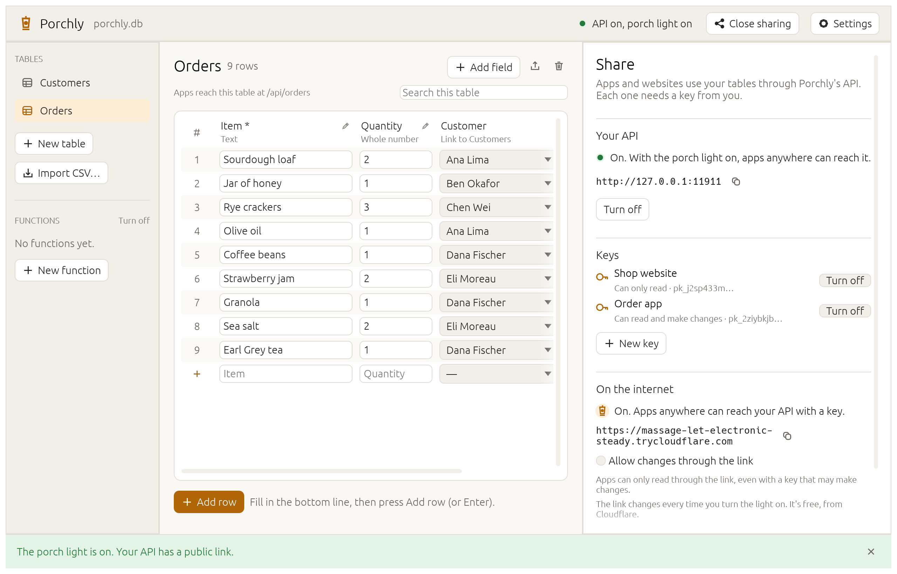
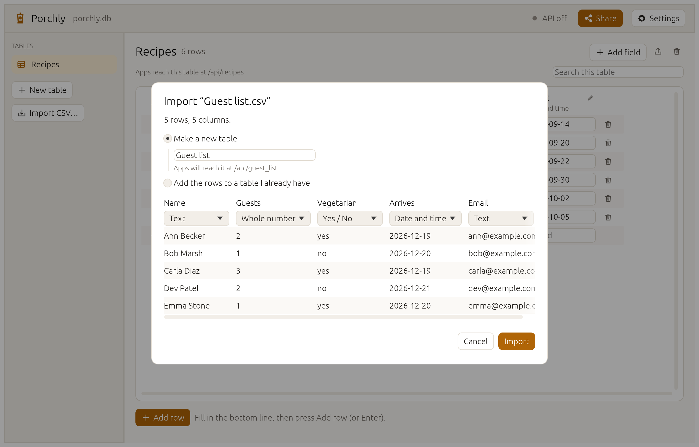
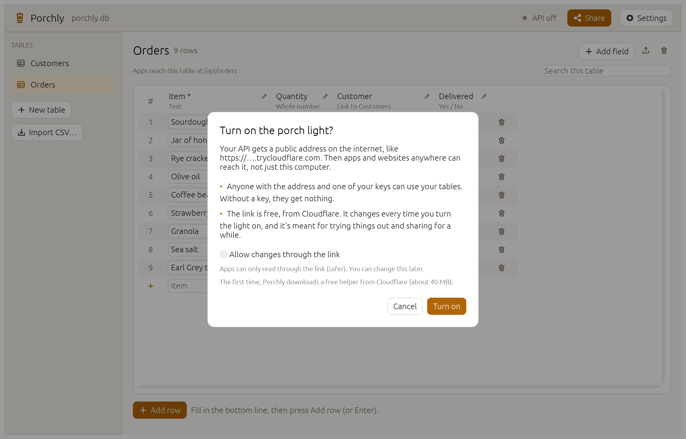
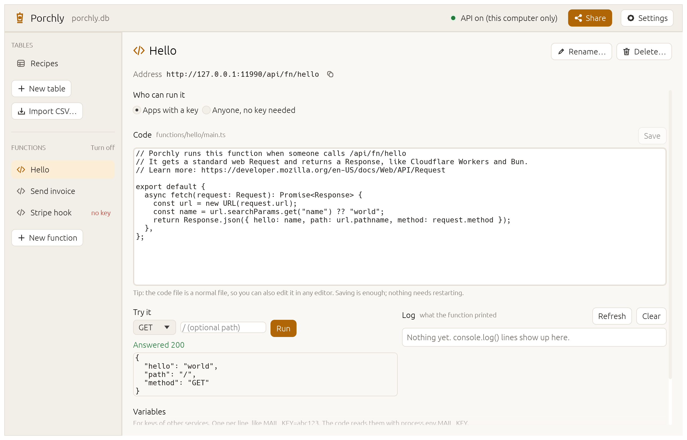
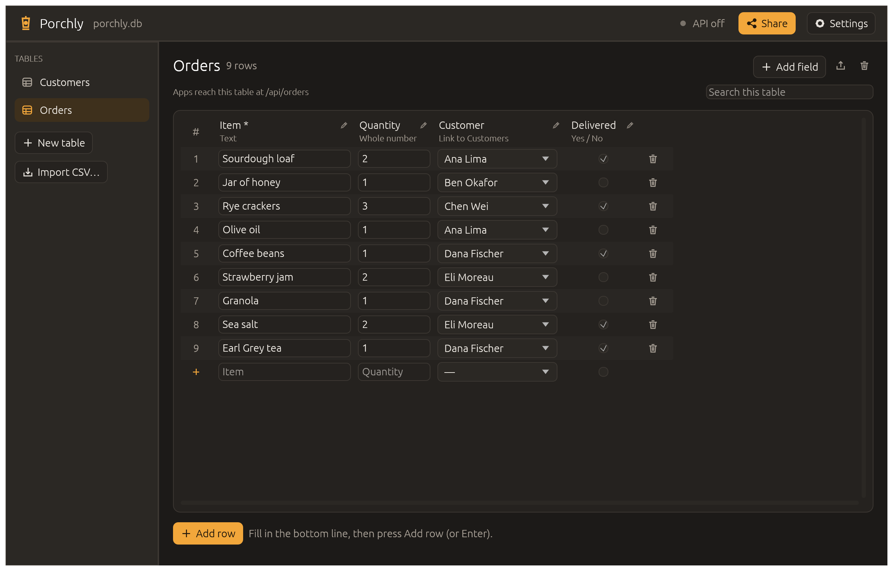

<p align="center">
  <picture>
    <source media="(prefers-color-scheme: dark)" srcset="assets/brand/porchly-logo-dark.png">
    
  </picture>
</p>

<h3 align="center">Your own database and API, in one app.</h3>

<p align="center">
  Make a table like a spreadsheet, and apps and websites can use it straight away.<br>
  No server, no account, no setup. Your data stays on your computer.
</p>

<p align="center">
  <a href="https://github.com/YasserManss/porchly/releases/latest/download/porchly-windows-x64.zip"><b>Download for Windows</b></a>
  &nbsp;·&nbsp;
  <a href="https://github.com/YasserManss/porchly/releases/latest/download/porchly-macos.zip"><b>Download for Mac</b></a>
  &nbsp;·&nbsp;
  <a href="https://github.com/YasserManss/porchly/releases/latest/download/porchly-linux-x64"><b>Download for Linux</b></a>
</p>

<p align="center">
  <a href="https://github.com/YasserManss/porchly/actions/workflows/ci.yml"></a>
  <a href="https://github.com/YasserManss/porchly/releases/latest"></a>
  <a href="#licence"></a>
</p>

<p align="center">
  
</p>

## What is Porchly?

Porchly is a small app that gives you a **database** and a **live API** (a way for other apps to read and change your data) in one double-click. You make tables that look like a spreadsheet; each one is instantly available to your website, phone app, spreadsheet script or AI agent. When you want it reachable from anywhere, turn on the **porch light** and you get a public link.

Things people build with it:
- a sign-up sheet that a club's website fills in
- a stock list a shop's app reads and updates
- a recipe box a phone can open from anywhere
- the backend for a prototype, a hackathon or a home-automation script

## Try it in two minutes

1. **Download** Porchly for [Windows](https://github.com/YasserManss/porchly/releases/latest/download/porchly-windows-x64.zip), [Mac](https://github.com/YasserManss/porchly/releases/latest/download/porchly-macos.zip) or [Linux](https://github.com/YasserManss/porchly/releases/latest/download/porchly-linux-x64). It's one file. Nothing gets installed.
2. **Open it.** The first time, Windows or macOS asks whether to trust it ([what to click](docs/download.md#the-first-time-you-open-it)).
3. Click **Add a sample table**. You now have a recipes table, and your API is running on your computer.
4. Click **Share → New key**, give it a name, and copy the key.
5. Ask your API for the recipes, from a terminal:
   ```sh
   curl -H "Authorization: Bearer YOUR_KEY" http://127.0.0.1:11911/api/recipes
   ```
   Or click **Share → For developers → Open API docs** for a guide with examples made for your tables.
6. Want to reach it from your phone or a website? Click **Turn on the porch light**.

## What it does

### Tables that feel like a spreadsheet
Type straight into the grid. Fields can be text, numbers, yes/no, dates, or **links to rows in another table** (orders → customers). Search, page through thousands of rows, and change or rename fields later: Porchly converts what's there, or tells you which rows don't fit. Bring in a spreadsheet by dropping a **CSV file** on the window, and export any table back to CSV.

<p align="center"></p>

### An API the moment you make a table
Every table is a REST API at `/api/<table>`: list, filter (`?minutes=lt.30`), sort, search, follow links (`?expand=customer`), add, change and delete. Every project comes with a readable guide at `/docs` and a machine-readable description at `/api/openapi.json`, so tools and AI agents can use it without help.

### The porch light: a public link
One click gives your API an `https://…trycloudflare.com` address that works from anywhere, with no router settings or account. Porchly explains what that means before it turns on, and links are **read-only unless you allow changes**.

<p align="center"></p>

### Functions: your own code behind the API
Need to send an email when an order comes in, or accept a webhook from Stripe? Write a small JavaScript or TypeScript function and it's live at `/api/fn/<name>`. Functions are off until you turn them on; Porchly then downloads [Bun](https://bun.sh) once to run them. Try them right in the app.

<p align="center"></p>

### Light and dark
It follows your system.

<p align="center"></p>

## Safe by default
- **Only your computer can reach the API** until you turn on the porch light.
- **Every request needs a key.** Keys can only read unless you say otherwise, and you can turn any key off. Porchly shows a key once and keeps only its fingerprint.
- **Through the public link, apps can only read** unless you tick "Allow changes".
- **Requests are rate-limited** (you choose how many per second in Settings) and size-limited.
- **Before deleting a table or a field, or changing a field's type, Porchly saves a snapshot** of your project.
- **No administrator rights, no background service, no telemetry.**

## Your data stays yours
Porchly is portable. Your tables live in one file in a **Porchly data** folder next to the app. Copy both to a USB stick or another computer and everything comes along. Delete them and Porchly is gone. The data file is standard [SQLite](https://sqlite.org), readable by countless other tools.

## Questions

**Does it cost anything?** No. Porchly is free and open source. The porch light uses Cloudflare's free quick tunnels.

**Do I need an account or the internet?** No account at all. The internet is only needed for the porch light and, once, to download the helpers for the porch light and functions.

**Is the public link permanent?** Not yet. It changes every time you turn the light on, and Cloudflare's free links are meant for trying things out. A permanent address is planned.

**Can several people edit at once?** Yes, through the API: every app with a key reads and writes the same tables.

**Is it ready for my business?** Not yet. Porchly is young (version 0.1). Keep your own copies of anything important. See the [roadmap](ROADMAP.md).

**How do I get in touch?** For a bug or an idea, open a [GitHub issue](https://github.com/YasserManss/porchly/issues). For anything else, write to [jiss.saudi@gmail.com](mailto:jiss.saudi@gmail.com).

## For developers
Building from source, running the tests and how the code is organised: [CONTRIBUTING.md](CONTRIBUTING.md). Reference documentation:
[API](docs/api.md) · [Functions](docs/functions.md) · [Porch light](docs/porch-light.md) · [Settings](docs/settings.md) · [Command line](docs/cli.md) · [Remote control](docs/control-protocol.md)

Porchly is written in Rust, with [egui](https://github.com/emilk/egui) for the window, [axum](https://github.com/tokio-rs/axum) for the API and SQLite for storage.

## Licence
MIT or Apache-2.0, at your option ([LICENSE-MIT](LICENSE-MIT), [LICENSE-APACHE](LICENSE-APACHE)). Artwork and screenshots: see [ATTRIBUTION.md](ATTRIBUTION.md).
